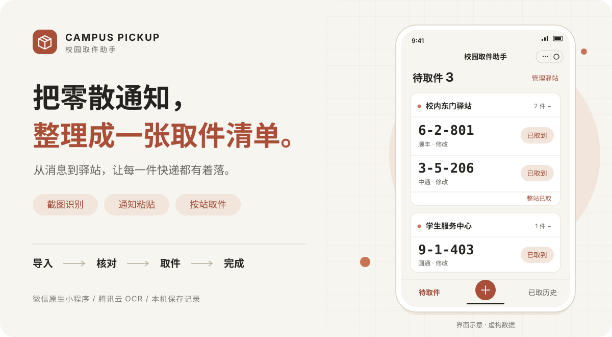

<p align="center">
  
</p>

<h1 align="center">校园取件助手 · Campus Pickup</h1>

<p align="center">
  截图识别，通知粘贴，按驿站整理。<br>
  让取件码不再散落在相册和消息里。
</p>

<p align="center">
  
  
  
</p>

<p align="center">
  <a href="#功能一览">功能一览</a> ·
  <a href="#使用流程">使用流程</a> ·
  <a href="#本地运行">本地运行</a> ·
  <a href="#开发与验证">开发与验证</a> ·
  <a href="https://github.com/cooper985/campus-pickup/issues">问题反馈</a>
</p>

---

取一个快递，常常要翻短信、找截图、切换应用，再确认它在哪个驿站。校园取件助手把这些零散信息汇总成按地点分组的待取清单：导入后看清取件码，取完标记，需要时再从历史恢复。

> 当前开发版本为 **V3.0.2**。封面是根据现有界面绘制的示意图，地点与取件码均为虚构数据。

## 功能一览

| 功能 | 能做什么 |
| --- | --- |
| **截图批量识别** | 一次选择最多 9 张截图，通过腾讯云 OCR 提取取件信息；单张失败可以重试。 |
| **粘贴取件通知** | 直接粘贴完整通知，在本机解析取件码、快递公司与地点。 |
| **自动整理与复核** | 信息充分时自动导入；有冲突或信息不足的候选进入待处理，支持查看来源并修正。 |
| **重复信息处理** | 结合图片摘要与包裹信息识别重复来源，减少反复导入；支持撤销本次导入。 |
| **按驿站取件** | 地点分组、大字取件码、点击复制；支持单件标记已取和整站批量标记。 |
| **驿站管理** | 修改名称、维护别名、合并地点、长按拖动排序。 |
| **已取历史** | 回看已取记录、恢复待取，也可以删除历史记录。 |
| **本地保存** | 取件记录与驿站设置保存在当前设备，重新打开可继续使用。 |

## 使用流程

**导入信息 → 查看整理结果 → 按站取件 → 标记已取**

1. **导入**：在「导入」页选择截图，或点击「粘贴通知」输入完整取件通知。
2. **核对**：查看新增、重复与失败统计；有待处理项时，核对取件码和地点后再确认。
3. **取件**：在「待取件」页按驿站查看，点击取件码即可复制，取完点击「已取到」。
4. **回看**：到「已取历史」查找记录；误操作时可恢复待取，支持的操作也会提供撤销入口。

<details>
<summary><strong>数据保存与识别边界</strong></summary>

- **通知文字**在本机解析，不上传到 OCR 服务。
- **截图识别**需要联网，图片会上传到微信云存储，再由云函数调用腾讯云 OCR；代码包含服务端清理与客户端兜底，实际清理和生命周期配置需在部署环境核实。
- **取件记录保存在本机**，目前没有跨设备同步。清理小程序数据或更换设备后，记录不会自动恢复。
- OCR 和地点关联可能出错，取件前仍需核对。仅有相同取件码与地点、缺少独立运单等身份信息时，系统无法始终区分重复截图与不同包裹。

</details>

## 本地运行

### 1. 获取项目

```sh
git clone https://github.com/cooper985/campus-pickup.git
cd campus-pickup
```

### 2. 导入微信开发者工具

使用微信开发者工具导入**仓库根目录**，将 `project.config.json` 中的 `appid` 改为自己的小程序 AppID。配置已指定：

- 小程序目录：`miniprogram/`
- 云函数目录：`cloudfunctions/`
- 业务首页：`pages/pickup/index`

小程序前端使用原生 WXML、WXSS 和 JavaScript，无需额外前端构建。编译后，可先通过「导入 → 粘贴通知」体验本机解析与取件清单，这条路径不依赖 OCR 云函数。

下面的通知可用于体验，内容均为虚构：

```text
【顺丰速运】您的快递已到校内东门驿站，取件码为6-2-801，请及时领取。
```

### 3. 按需接入截图 OCR

截图入口使用真实云端识别，克隆仓库不会自动获得原项目的云环境访问权限。

<details>
<summary><strong>展开查看 OCR 配置要点</strong></summary>

1. 准备自己的微信云开发环境与腾讯云 `GeneralBasicOCR` 服务。
2. 将 [recognition-task.js](miniprogram/services/recognition-task.js) 的 `CLOUD_ENV`，以及 [云函数入口](cloudfunctions/recognizePickup/index.js) 中的环境 ID 校验与 `envId` 改为自己的环境。当前服务端区域使用 `ap-shanghai`，更换区域时也需同步调整客户端调用配置与服务端校验。
3. 安装 `cloudfunctions/recognizePickup/` 中的依赖，部署 **`recognizePickup`** 云函数。`quickstartFunctions` 属于保留的模板示例，正式取件页不依赖它。
4. 配置 `OCR_MODE=real`、`OCR_ALLOWED_OPENIDS`（允许使用的用户 OpenID）、`OCR_FILEID_READY=1` 和 `OCR_TEMP_BUCKET`（临时图片存储桶）。通过云函数运行角色提供临时凭证与所需 OCR 权限，不在前端填写密钥。
5. 核实临时文件的私有访问规则、清理及生命周期配置，再启用截图识别。实际额度、计费、运行时和权限以自己的云环境为准。

当前 `fileID` 识别链路要求真实模式、白名单及环境校验同时通过；仅修改 AppID 或保留默认 `mock` 配置，无法使用截图入口。历史 Base64 接口保留用于兼容。

</details>

## 开发与验证

### 技术组成

| 层级 | 实现 |
| --- | --- |
| 界面 | 微信原生小程序 · WXML / WXSS / JavaScript |
| 识别 | 微信云存储 `fileID` → 云函数 → 腾讯云 `GeneralBasicOCR` |
| 整理 | 通知解析、OCR 布局分析、候选融合、重复判断与导入决策 |
| 保存 | 微信本地存储，包含版本信息、备份与异常保护 |
| 回归 | Node.js 内置测试运行器、内存存储与离线 OCR 留样 |

### 目录结构

```text
campus-pickup/
├── miniprogram/
│   ├── pages/pickup/          # 待取、导入、历史与驿站管理
│   └── services/             # 识别、解析、融合与本地存储
├── cloudfunctions/
│   └── recognizePickup/      # OCR 云函数及 fileID 处理
├── tests/                    # 本地回归与识别用例
├── docs/                     # 存储说明、工程记录与首页素材
└── project.config.json       # 微信开发者工具项目配置
```

### 本地回归

使用 Node.js 24，在仓库根目录运行：

```sh
node --test tests/*.test.js
```

测试使用内存存储、SDK 替身和离线 OCR 缓存，不调用真实 OCR，也不清空微信存储。部分历史对照需要完整 Git 历史；私有留样缺失时会明确跳过。合成测试和历史离线回放不代表真机体验或总体识别准确率。

微信 UI 优先使用开发者工具检查。独立的浏览器布局脚本不包含在上述命令中；Android / iPhone 真机表现需要另行验证。

更多工程信息：[V3.0.2 修复记录](docs/stability-v3.0.2.md) · [本地存储设计](docs/local-storage.md) · [OCR 验证工具](tests/live-ocr/README.md)

## 反馈与改进

欢迎通过 [Issues](https://github.com/cooper985/campus-pickup/issues) 反馈识别问题和使用建议。描述问题时附上操作步骤、预期结果与实际结果；若提供截图，请先遮盖姓名、手机号、地址、运单号及真实取件码。

<p align="center">
  <sub>少翻几次消息，少找一张截图。</sub>
</p>

