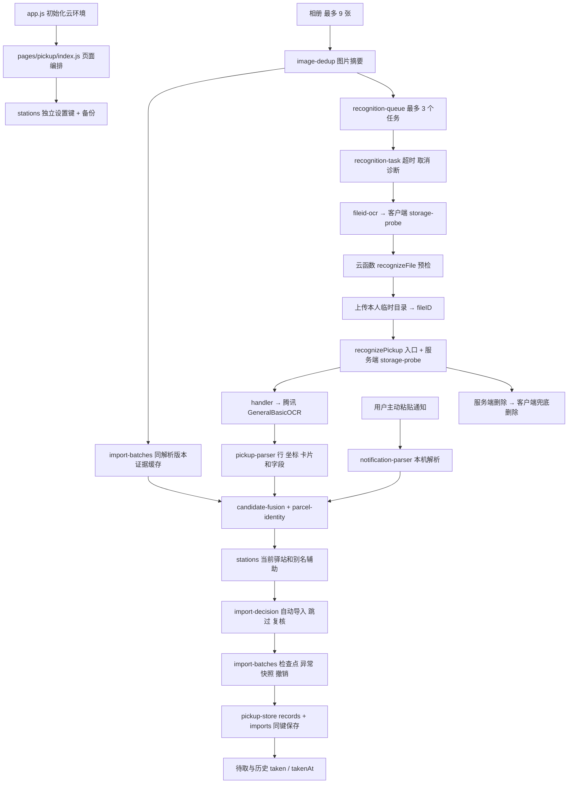

# 校园取件助手 V3.0 工程审计

审计日期：2026-10-25（Asia/Shanghai）

项目：`/Users/a1/Projects/快递管理app/微信小程序`

实际 HEAD：`add1b1bd6a7b57eec5235addf1808a9eee0626fa`（`add1b1b`）

审计前工作区：仅 `?? AGENTS.md`，受版本管理文件无修改。本文是本轮唯一新增项目文件；未修改代码、配置、依赖、数据或既有报告，未提交、部署、推送或发布。

审计依据为当前源码、全部测试文件、当前跟踪文件清单及本地 verification 记录。下文代码路径均相对于上述项目根目录，行号对应受审 HEAD。历史报告仅作为历史证据，不代表当前云端或当前版本已完成验收。

证据分为：**已确认缺陷**（源码加纯内存反例）、**潜在风险**（代码具备相应条件，但真实业务或线上配置未证实）、**验证缺口**（缺少必要实测）。合成反例证明可触发，不证明真实截图中的发生频率。

## A. 项目架构总览

### A1. 实际入口与依赖

- `miniprogram/app.js:3–21` 初始化云环境；环境常量来自 `services/recognition-task.js`。
- `miniprogram/app.json:2–6` 注册 3 个页面，首页是 `pages/pickup/index`；`pages/index/index`、`pages/example/index` 仍是 QuickStart 演示页面。
- 唯一自定义组件 `components/cloudTipModal` 属于模板演示链路。生产取件页面主要使用微信原生组件，没有前端 npm 框架。
- `cloudfunctions/recognizePickup/package.json` 锁定 `tencentcloud-sdk-nodejs-ocr@4.1.328`、`wx-server-sdk@4.0.2`，有 `pnpm-lock.yaml`。没有引入生产 AI 框架或 Python OCR 运行时。
- `cloudfunctions/quickstartFunctions` 是另一条模板云函数链路，使用 `wx-server-sdk ~2.4.0`，没有锁文件。取件业务不依赖它。
- `project.config.json` 指定小程序/云函数根目录，基础库配置为 `2.20.1`。这不等于当前手机实际使用相同基础库。

### A2. 业务数据流



图片链路中，前端默认上传二进制文件，通过小参数 `fileID` 调云函数；Base64 主要在服务端内存中生成。前端 `cloud-ocr.js` 的旧 Base64 适配器仍保留作兼容/回归用途，当前页面不调用。`storage-probe.js` 虽名为 probe，**正在承担生产 fileID 通道，不能当实验文件删除**。

通知文字在本机解析。页面不会主动读剪贴板。正式记录持久化边界不保存图片字节、图片路径或完整 OCR 原文；批次保存结构化候选、来源区域、图片摘要和决策快照。

### A3. 模块职责与依赖评价

| 模块 | 实际职责 |
|---|---|
| `pages/pickup/index.js` | 选图、通知、任务生命周期、批次恢复、复核、导入、记录编辑、待取/历史、驿站管理、拖动与动画；1363 行，是主要编排集中点 |
| `pickup-parser.js` / `recognition-layout.js` | OCR 行与坐标、标签及无标签码、通知段落委托、地点/区域关联、共享驿站和结果原因 |
| `notification-parser.js` | 通知分块分句、取件标签/凭码表达、地点与承运商提取；也被 OCR 适配器复用 |
| `pickup-code.js` / `station-name.js` | 共享取件码合法性、地点正文截断及可疑名称判断 |
| `pickup-duplicates.js` | 承运商/运单元数据、旧确认导入的去重和补充计划 |
| `parcel-identity.js` / `candidate-fusion.js` | 身份关系、字段冲突、整组全对全关联、来源追踪和多图融合 |
| `import-evidence.js` | 物流状态、通知事件日期、状态时间顺序、导航标签过滤 |
| `import-decision.js` | 自动导入/跳过/复核；历史同码保护、手工字段保护和有依据的信息补充 |
| `import-batches.js` / `import-results.js` | 候选白名单、检查点、解析版本缓存、批次快照/撤销、结果分类和保留策略 |
| `pickup-store.js` | 包裹与批次同一存储 envelope、验证、备份、回读确认、陈旧写入保护 |
| `stations.js` | 稳定 ID、发现/确认、别名、地址记忆、排序、合并重定向、解绑和删除墓碑；独立设置存储 |
| `recognition-queue.js` / `recognition-task.js` | 排队、取消等待、超时、迟到结果检查、开发版安全诊断 |
| `fileid-ocr.js` / 两端 `storage-probe.js` | 预检、压缩、上传、路径所属校验、下载/OCR、两端删除与清理状态 |
| `recognition-diagnostics.js` / `mock-ocr.js` | 离线候选诊断和固定模拟输入；前者不进入普通页面持久化 |
| `tests/` / `verification/` | 纯函数与页面替身测试、脱敏回放、可选浏览器几何检查、真实 OCR 工具和历史验证记录 |

对 33 个自有 JS 文件的字面相对 `require()` 引用进行静态图检查，识别到 54 处引用，**未发现循环依赖或服务反向依赖页面**。图检查不覆盖 SDK 内部和运行时构造的未知依赖。

有两处层次耦合值得记录：解析器为取 `metadata` 引入 `pickup-duplicates → pickup-store → import-batches`；`stations` 为取 `UNKNOWN` 引入整个 `pickup-parser`。这是可维护性成本，尚不是循环依赖或重写理由。旧手动确认导入与新自动导入各有编排，正常完成和重启恢复已经出现保护规则漂移，见 P1-01；优先统一这一个规则入口即可。

### A4. 数据模型与保护边界

| 数据 | 实际结构与行为 | 审计判断 |
|---|---|---|
| 包裹/历史 | `pickup-store.js:1–50,107–126`；`id, station, code, carrier, waybillNumber, taken, createdAt, updatedAt, takenAt`，另有可选地址、状态/事件时间、确认字段、站点 ID/原地点 | 历史与待取共用数组，以 `taken` 区分；唯一 ID、时间、长度和状态受校验 |
| 持久化 | `pickup-store.js:54–100`；`campus-pickup.records` v1 envelope 含 records/imports，另存前一版本 backup | 保存前比对旧值、先备份、写后回读，失败后阻断写入；没有清空真实存储的恢复路径 |
| 批次/异常 | `import-batches.js:3–56,58–88`；images/candidates/reviews/outcomes/additions/updates/resolved | 候选字段白名单；异常选择与记录写入可同键保存；已确认的恢复分支遗漏见 P1-01 |
| 驿站 | `stations.js:3–33,78–118`；v1 groups、稳定 id、name、aliases、confirmed/discoveryStatus、可选 pickupAddress | 首次 ID 来自规范化名称；改名不换 ID；自动发现与用户确认有区分 |
| 合并/解绑 | `stations.js:145–152,195–200`；redirectIds / revokedAliases | 旧记录可凭重定向和原地点解析；合并遗失撤销标记见 P2-01 |
| 删除/恢复 | `stations.js:64–65,168–184,202–207`；deletedNames/deletedIds | 删除配置保留包裹；自动发现尊重墓碑，显式恢复避免重用已删除 ID |
| 撤销 | `import-batches.js:90–105`；页面 `818–828,1226–1276` | 自动导入撤销比对完整快照，保留后续修改；普通取件/删除等为 5 秒内存撤销，页面退出不保留 |
| 兼容/迁移 | `pickup-store.js:15–40`、`stations.js:83–105` | 旧 v1 缺新增可选字段可读；未知版本/损坏阻断保存；仅对未确认旧站名做保守规范化，不猜测迁移 |

`records/imports` 与 `stations` 分属两个键，不能构成跨键事务。包裹先保存、站点设置随后失败时会显示 `stationBlocked`，记录可按名称回退，未发现由此直接删除包裹。应保留这一恢复边界，后续修复不要将设置保存失败误当成整批入库失败而重复新增。

自动补充 `import-decision.js:45–57` 只填空字段，并尊重 `confirmedFields`；未发现自动识别直接替换已有非空包裹地点/公司/地址的路径。不过页面编辑会意外回写站点地址记忆，见 P2-02。

## B. 当前工程质量评价

| 方面 | 评价 | 依据与限制 |
|---|---|---|
| 架构合理性 | 适合小规模、本机存储的校园试用，需先修正确性问题 | 传输、解析、融合、决策、存储已拆分，无循环；不需要新框架、微服务或换数据库 |
| 可维护性 | 中等，关键风险来自分支规则漂移 | 页面 1363 行、解析和站点模块表达密集；正常完成/恢复与两种输入适配器已有实际差异 |
| 文件组织 | 业务代码基本清晰，模板及验证资料的用途标记不足 | services/tests/fixtures/verification 合理；README 仍为模板，模板页面仍注册；无需为整洁搬目录 |
| 数据安全 | 有实质保护，但不能宣称零漏件或绝不覆盖 | 备份、回读、陈旧写入保护、确认字段、墓碑和撤销较完整；状态串卡、恢复与记忆错误已复现 |
| 测试有效性 | 本地回归较好，设备和组合边界不足 | 本轮 218 项通过；7 个缺陷仍可在测试外构造；微信真实渲染、进程退出和存储配额不由 VM 证明 |
| 运行性能 | 没有证据断言当前存在性能瓶颈 | 有最多 9 图/3 并发/摘要缓存，前端 fileID 避免 Base64 大参数；缺当前 Android/iOS 性能数据，长列表和批次增长需实测 |

### B1. 识别、并发和性能专项结果

1. **提取规则确有两套输入适配逻辑。** 共享合法性校验是合理的，几何 OCR 与通知分句不宜强行合并；标签语法已出现漂移，见 P2-05。`analyze()` 在 `parse()` 后再次执行 `extractCodes()`，有重复扫描，但没有测出其为瓶颈。
2. **地点边界部分共享、可信度仍分别维护。** `station-name.boundary` 被复用，OCR 的 `validPlace`、通知的 `places`、站点的 `reliable/canonical/normalize` 服务于不同阶段。应针对真实差异收敛小规则，不宜把所有规范化一律合并。
3. **区域职责尚未完全统一。** 通知有分句，OCR 有局部 section/共享站点；身份元数据、状态 scope 和展示 region 的范围并不总一致，P0-01 是实际后果。
4. **融合有防桥接措施。** 整组全对全比较、不同完整运单阻断、同图同码/异时间冲突进入复核；仍有仅“码 + 站”证据不足的策略边界，见 P1-02。
5. **状态顺序使用事件时间。** 没有拿文件/上传时间排序；未知状态不直接制造冲突。两标签导航和通用卡片边界仍可能制造伪冲突甚至错误终态。
6. **缓存版本隔离成立。** `PARSER_VERSION='2.3.4'`；`cachedImage:113–118` 仅命中同版、done 证据。页面 `595–605` 重建来源并重跑驿站/决策。解析器变化时必须同步升级版本；当前没有证据证明版本漏升。开发诊断 build 仍为旧名称，是诊断元数据问题。
7. **批内融合与最终写入不等于重复入库。** 图片检查点先保存，全部结束才融合；`completeAutoBatch:693–712` 有签名和已处理来源保护，`evaluate` 每次对现有记录重分类。中断恢复未复用其中一个保护，见 P1-01。
8. **取消主要防止迟到结果落入页面。** `current()`、run 身份、任务控制 check、卸载取消与 queued 取消均存在。取消不等于终止 `wx.cloud.callFunction`；队列通常等底层 work settle 后再放行。内层 `storage-probe.step:29–43` 自身有 60 秒 Promise.race，因此不能据此承诺物理网络请求永远不超过 3 个，或停止后不再消费已提交 OCR。未发现已提交任务迟到后越过 run 身份检查直接入库的证据。
9. **失败恢复保守但需要用户重新选图。** 已落盘候选可恢复；原图路径仅在内存，强退后未成功的图片需要重选。服务端 finally 删除、客户端兜底删除、上传超时后的迟到删除均有实现及替身测试；双端失败仍依赖实际云生命周期。当前生命周期配置未在线核验，不能承诺精确 24 小时删除。
10. **内存/渲染仅能给出成本位置。** fileID 通道前端保留路径，服务端校验 OCR 图片上限；页面 `batchImagePaths` 到卸载才清空，压缩临时图未显式 unlink；多次 `setData` 和 `updateRecords` 会重建多份分组及展示列表。保留规模、临时空间回收和长列表时延未测，不能把这些静态现象写成已发生泄漏或卡顿。`onHide` 不取消识别、`onUnload` 才取消，需在真机验证微信后台行为。

### B2. 测试体系

本轮用 Node **v24.22.1** 执行 `node --test tests/*.test.js`：**218 通过、0 失败、0 跳过，约 5.19 秒**。测试输出留在系统临时目录，未新增测试报告文件。28 个测试文件共 215 处 `test()` 声明，`import-review.test.js:7–8` 的四档循环额外展开 3 项。

| 按文件主要用途分类 | 数量 | 实际范围 |
|---|---:|---|
| 云函数、传输与任务控制 | 23 | cloud-ocr、fileid-ocr、ocr-entry、ocr、storage-probe、recognition-task |
| 解析、关联与驿站记忆 | 55 | cainiao-parser、pickup-parser、notification-address、recognition-regression、v22-recognition、v233-recognition、v234-memory |
| 存储与去重合并 | 17 | pickup-store、pickup-merge |
| 页面导入与业务交互 | 113 | pickup、pickup-ui、pickup-ux、import-review、v12/v121/v122、v23/v231/v232-import |
| UI 专项 | 6 | ui-v2、v30-ui |
| 离线真实 OCR 工具 | 4 | live-ocr |

该分类的业务覆盖有交叉，不能视为独立功能的精确覆盖率。单元测试和页面集成测试都有；**没有本轮执行的微信端到端测试**。`helpers/page.js:7–16` 的 VM 执行真实页面代码，但 `setData` 是同步赋值；SDK、网络与存储由替身实现，不涵盖真实渲染/桥接/磁盘配额。

- 保护力度较好的路径：存储读写失败、写后抛错/静默失败、备份与陈旧页面保护、手工字段锁、历史同码、批内融合、缓存版本、取消迟到结果、fileID 所属路径、删除兜底和撤销冲突。
- 未覆盖的组合边界：通用卡片状态串卡；已处理记录删改后重试检查点中断；解绑后跨站合并；只改旧包裹码不回写地址记忆；规范化同名改名；同通知同码重复提及。C 节均给出最小复现方法。
- 未发现已经成立的测试顺序依赖或共享存储污染。helpers 每次创建独立内存存储；部分测试重写 fake API 是有意注入失败。`ui-v2.test.js:14` 使用真实 230ms 等待，可能受调度影响，属于脆弱性而非当前失败。
- 部分 UI 测试只检查源码字符串，例如 `import-review.test.js:47–60`；可防止特定布局约束回退，但对等价改名敏感，不能证明真实可用性。不必因数量多就删测试，后续改动时优先保留行为断言。
- `review-layout.cjs`、`v231-layout.cjs`、`v30-layout.cjs` 为 Chrome 近似几何检查，前两者用手写近似 HTML，后者转换 WXML/原生组件；都不是微信原生端到端测试。本轮未运行，遵守本地 `AGENTS.md`。
- 私有回放、Git 历史和浏览器依赖导致新克隆不可保证同等测试效果，见 P2-06。

真实/合成数据及指标边界：

- `tests/fixtures` 包含脱敏真实 OCR 文本/坐标与显式合成批次，命名和报告总体有区分；仍保留取件码/站名，不等于完全匿名。
- `verification/v233-report.md:11–25` 将腾讯真实、RapidOCR 和合成结果分开，承认开发样本不是独立留出集、身份/状态/日期标签不全，不能推算总体准确率。
- `verification/v234-evaluation.json:29–49` 分列腾讯 12 图/23 码、RapidOCR 4 图/6 码、合成 7 批。这些是历史有限语料结果，不是上线总体精度。
- `tests/experiments/evaluate-v234.cjs:38,43–48` 按 code 建 `expectedParcels`，以合并组是否出现不同码作为 `wrongMerges` 的主要代理；**无法检验两件不同包裹复用同一码**。不能用该指标为 P1-02 背书。
- 旧 `v23-live-ocr-report.md` 与当前 report 构建逻辑预期有版本差异，应保留为历史快照，不引用为当前 HEAD 的独立验收，也不在本轮运行覆盖命令更新它。

## C. 已发现问题与风险

优先级按本轮定义：P0 可能造成漏包裹/数据损失/严重安全后果；P1 明显影响稳定性或需上线前处置；P2 一般质量问题；P3 可选优化。**缺陷等级表示后果，不表示真实发生概率。** 以下确认了 7 个可复现代码缺陷；潜在身份风险、线上风险及验证缺口单独标识。

### P0-01：状态跨卡片归属，可能把待取包裹自动跳过【已确认】

- **代码位置：** `miniprogram/services/pickup-parser.js:206–216`，`parse()`；`import-decision.js:35`，`classify()`；同类导航边界在 `import-evidence.js:54–61`。
- **具体问题：** 通用多码回退的状态 scope 从当前码行截到下一码之前，漏掉当前码上方状态、吸入下件码上方状态；展示的 `sourceRegions.start/end` 还与实际状态范围不一致。终态随后被当可靠证据自动跳过。
- **触发条件/验证：** 对以下输入提供逐行 `{x:20,y:i*50,width:150,height:30}` 坐标，再执行 `analyze → fuse → evaluate(..., [])`：

  ```js
  ['甲大学驿站', '待取件', '取件码1111',
   '乙大学驿站', '已取件', '取件码2222']
  ```

  本轮实际结果：`1111 → collected → AUTO_SKIP/terminal`，`2222 → unknown → AUTO_IMPORT/reliable`。待取项被漏掉，已取项反而进入待取。
- **影响范围：** 未命中特定 sectionBounds 的多卡/多码 OCR。另一个入口是仅两个同水平导航标签：当前只剔除至少三个标签，`全部/已取件` 可污染下方单包裹终态；其真实布局出现情况待采样。
- **建议方式：** 让事件、身份和展示证据使用同一可解释卡片边界；无法可靠隔离的终态降为复核。覆盖状态在码前/码后、交换状态、两列、有效码与缺码混排，检查来源区域包含真正的状态证据。
- **修改风险：** 中等；需保护菜鸟共享驿站多卡继承和既有通知委托逻辑。不要简单全局删除状态判断。
- **是否立即处理：** **是，自动导入试用/上线前必须修复。** 现有 `v233-recognition.test.js:29–35` 的特定分节测试不足以覆盖此反例。

### P1-01：中断恢复绕过已处理来源保护，会复活已删改包裹【已确认】

- **代码位置：** `miniprogram/pages/pickup/index.js:735–744`，`recoverInterrupted()`；对照 `completeAutoBatch:698–701`；重试检查点 `576,681–687`。
- **具体问题：** 正常完成会把“来源曾处理、现在又像新记录”的候选降为 `batchConflict`；恢复只过滤 `resolved`，直接重新 evaluate，漏掉同一保护。
- **触发条件/验证：** 已完成批次保留来源 A 的 images/additions/outcomes；用户删除该包裹或改其取件码；重试另一失败图使批次变为 processing，随后强退。纯内存构建同样存储状态并重新 `page.onLoad()`，本轮 records **0 → 1**、旧码 `1234` 复活、复核数 0。
- **影响范围：** 含已处理来源的重试批次，在 processing/interrupted 状态重启。不是普通首次导入必现。
- **建议方式：** 复用正常入口的 eligible/handled 保护；为“删除或改码 → 另一图重试检查点 → 重启”补一个参数化页面回归，确认不自动复活。
- **修改风险：** 低到中；小范围统一候选筛选即可，不需要重构整个导入状态机。
- **是否立即处理：** **是，上线前修复。**

### P1-02：仅凭同码同站静默合并，证据不足时可能漏掉另一件【潜在风险】

- **代码位置：** `miniprogram/services/parcel-identity.js:7–13`；`candidate-fusion.js:9–24`；`import-decision.js:19–21,45–57`。
- **具体问题：** 已确认代码行为：不同 `sourceIndex` 的同码、同站 pending 候选，无运单/日期时可融合为 1 件；对已有同码同站待取则自动跳过。是否实际属于两件，缺失证据无法判定，本轮没有真实误合并样本。
- **触发条件：** 驿站重复使用取件码，旧待取实际已取但用户未核销，或两个截图实际代表不同包裹；同时无可用日期/完整运单。
- **影响范围：** 依赖弱身份的跨图融合和重复导入。真实相同截图的摘要去重不受此结论否定。
- **建议方式/验证：** 明确产品策略；对不同图片摘要、身份只有“码 + 站”的歧义保留不确定性/复核入口。分别验证真正重复与同码复用，避免全盘禁用融合。当前离线 `wrongMerges` 指标无法验证这一边界。
- **修改风险：** 中等，会增加复核量；“真实属于几件”的期望需要人工标签，不能由现算法输出自证。
- **是否立即处理：** 试用前明确边界和复核策略；若要求自动导入尽量不漏件，应在扩大试用前处理，不能承诺零漏件。

### P1-03：模板云函数若已部署，存在无业务授权的演示写操作【潜在安全风险】

- **代码位置：** `cloudfunctions/quickstartFunctions/index.js:168–184` 分发，`89–156` 对 `sales` 增改删，`19–30` 生成并上传固定 `code.png`；模板页面仍在 `app.json:3–5` 注册。
- **具体问题：** 演示函数接受客户端数据/记录 ID，未实现取件业务用户级授权与隔离。是否线上部署、哪些用户可调用、集合是否存在，本轮未访问云端核实。
- **触发条件/影响：** 该模板函数在线且可调用时，可能改写演示集合或写云资源；不能据此声称已泄露取件记录，正式包裹仍为本机存储。
- **建议方式/验证：** 上线前只读核对线上函数、权限、用途与入口；确认无用后在后续获准变更中停止发布/调用，或按真实用途补授权。不要本轮删除模板或改云资源。
- **修改风险：** 中等，需要确认演示是否仍用于维护流程；不要误伤 `recognizePickup`。
- **是否立即处理：** **上线前必须核实；确认暴露后再处置。**

### P1-04：当前版本缺少完整手机验收，自动导入可靠性尚未闭环【验证缺口】

- **证据位置：** `verification/v30-ui.json:28–29`；`v234-evaluation.json:452–455,481`；`tests/helpers/page.js:7–16`。
- **具体问题：** 当前版本未有完整 Android/iOS 真机证据。不能写“完全没测过 Android”：`android-fileid-ocr-result.json:2–63` 保存了旧版三图传输/OCR/删除成功诊断，但不覆盖当前 UI、恢复和九图全链路。
- **触发条件/影响：** 真机后台/强退、弱网、原生键盘、滚动触摸、磁盘/配额、压缩和安全区差异，都超出同步 VM 替身能力；实际是否失败未知。
- **建议方式/验证：** 修复 P0/P1 后，用隔离测试数据做一次精简 Android+iOS 验收：九图、单图失败重试、取消迟到、后台/强退恢复、复核键盘/滚动、存储保存和临时图清理。无需重复广泛桌面测试，不得清空真实用户存储。
- **修改风险：** 验证本身低，真实 OCR 仍须遵守既有额度与调用授权；本轮没有执行。
- **是否立即处理：** **上线前完成，封闭试用至少先覆盖主要目标设备。**

### P2-01：合并驿站遗失源站 revokedAliases，重新关联已解绑包裹【已确认】

- **代码位置：** `miniprogram/services/stations.js:145–152`，`merge()`；`resolve:112–114`。
- **具体问题：** 合并保留目标站撤销标记，未合入被合并源站的标记；旧 stationId 被 redirect 后，原本已解绑的原地点再次归入目标站。
- **触发条件/验证：** A=北门驿站绑定 X=北门便利店；从 X 导入的包裹保留 stationId=A/original=X；解绑 A/X 后正确显示 X；建立 B=西门驿站，再 `merge([B,A], '统一驿站')`。本轮结果：包裹从 X 错归统一驿站，独立 X 仍存在。
- **影响范围：** 含旧 stationId 的记录及后续站点匹配；没有删除记录，但违背用户明确解绑选择。
- **建议方式：** 合并双方 revokedAliases，仅移除本次明确重新接纳的 aliases；保留旧 ID/原地点的回归。
- **修改风险：** 中等，需验证两个合并方向与显式重新关联。
- **是否立即处理：** 建议试用前处理；优先级高于纯目录整理。

### P2-02：只改旧包裹取件码，会回退较新的驿站地址记忆【已确认】

- **代码位置：** `miniprogram/pages/pickup/index.js:1332–1333,1348,1360`，`saveEdit()`；`stations.js:175`，`remember()`；`assist:165`。
- **具体问题：** 编辑提交携带全部字段，即使只改码也调用 remember；任何非 undefined 地址都会覆盖站点记忆。
- **触发条件/验证：** 旧包裹地址“旧楼一层”；站点后来已确认“新楼二层”；只改旧包裹 code。纯内存页面实测记忆回到“旧楼一层”，不需要勾选位置关联。
- **影响范围：** 后续缺地址候选可能由记忆补入旧地址；已有包裹不会因此直接删除。
- **建议方式：** 按实际编辑字段差异更新记忆；修改码/公司不回写地址，显式改地址/清空地址的语义继续保留。补“只改码不回写新记忆”回归。
- **修改风险：** 低，需防止修复后用户主动清空地址失效。
- **是否立即处理：** 建议试用前顺手修复，工作量小且会覆盖用户较新的确认信息。

### P2-03：规范化等价的驿站改名会锁住设置保存【已确认】

- **代码位置：** `miniprogram/pages/pickup/index.js:347–348`、`saveStations:171`；`stations.js:29`。
- **具体问题：** 改名用原始字符串 Set 去重，存储验证按 normalize 拒绝重复；输入校验失败又被当成存储异常置 stationBlocked。
- **触发条件/验证：** “北门驿站”改为“北门 驿站”。本轮得到“驿站别名格式异常”、`stationBlocked=true`，须重启才能继续管理。
- **影响范围：** 仅空格、标点、大小写/全角等规范化等价改名；记录未丢失。
- **建议方式：** 别名按 normalize 去重；区分输入校验失败与真正未确认的写入失败，后者继续阻断保护。
- **修改风险：** 低，一条页面回归即可覆盖主要反例。
- **是否立即处理：** 非发布硬阻断，适合与站点修复一起处理。

### P2-04：同一通知重复提及同一码，被判为两条冲突异常【已确认】

- **代码位置：** `miniprogram/services/notification-parser.js:38–40,56–57`；`candidate-fusion.js:21–24`。
- **具体问题/触发条件：** 仅索引相距小于 3 的相同码会去重；“标签 + 凭码”重复提及距离更远，产生两条同 sourceIndex 候选。
- **验证：** `【菜鸟驿站】您的包裹已到大学驿站，取件码1234，凭1234取件。` 本轮 parse 得 2 条，最终 2 条 `NEEDS_REVIEW/batch_conflict`。
- **影响范围：** 通知导入及被委托到通知解析的 OCR 段落；增加复核负担，未确认直接丢记录。
- **建议方式：** 按同通知区域/身份合并重复提及；用两条独立通知同码作对照，不能直接全局按码去重。
- **修改风险：** 低到中，需保护真实同图同码多包裹。
- **是否立即处理：** 可在 P0/P1 之后处理。

### P2-05：OCR 与通知对取件标签语法的支持漂移【已确认】

- **代码位置：** `miniprogram/services/pickup-parser.js:10,33–40`；`notification-parser.js:42–53`。
- **具体问题/触发条件：** OCR 标签后不消费“为/是”；通知路径会消费。没有署名或完整到站句子的 OCR 行更容易落入该分支。
- **验证：** `analyze(['大学驿站','取件码为1234'])` 无记录且有异常；`parse('已到大学驿站，取件码为1234')` 正常得 `1234`。
- **影响范围：** 同一有效表达在不同入口表现不同；通常进入异常，不应称为全部静默丢件。
- **建议方式：** 共享标签词表和前缀消费规则，保留几何/文本适配器；回归电话、日期、链接、运单与掩码排除。
- **修改风险：** 低到中，正则拓宽需避免误识别。
- **是否立即处理：** 可后续处理，优先级低于误跳过问题。

### P2-06：测试运行环境和私有回放不完全可复现【已确认环境限制】

- **代码位置：** 根目录无 package.json/运行时声明；`tests/v30-layout.cjs:3–4`；`recognition-regression.test.js:14–25,74,87,99`；`cainiao-parser.test.js:13`；`live-ocr.test.js:13,28,37`；`fileid-ocr.test.js:18–20`。
- **具体问题：** 浏览器脚本依赖未声明的 playwright/xml-js；mock timers 的 Date API 要求合适 Node；固定旧提交对照要求完整 Git 历史；真实图/缓存被正确忽略，但缺失时部分测试跳过。
- **触发条件/影响：** 新克隆、浅克隆、源码压缩包或另一台机器不能保证本机 218 项的同等有效执行；不能把私有样本跳过后的绿灯解释为相同覆盖。
- **建议方式/验证：** 最小补充 Node 版本和安全测试命令；区分可公开复现集、私有回放集与可选浏览器检查。历史失败实现对照保留价值，可与日常核心回归分开；用干净克隆核验时不要复制私人数据。
- **修改风险：** 低；不必引入复杂测试平台或立即改依赖。
- **是否立即处理：** 多人协作或持续集成前处理；当前单机试用不因此阻断。

### P2-07：实时 OCR 工具自动盘点整个 test-data，可能带入后来加入的私人图【潜在风险】

- **代码位置：** `tests/live-ocr/run.cjs:21–38,68–71`，`inventory()/serve()`。
- **具体问题：** 递归收集全部 JPEG/PNG，只排 prepared-* 和自身缓存目录；不要求样本已有标签，桥接启动后按清单取下一张。
- **触发条件/影响：** 开发者后续把无关私人图放进 test-data，并主动运行 bridge/bootstrap；这些图可能进入真实 OCR，消耗额度并发送到服务端。本轮未运行该工具。
- **建议方式/验证：** 下次真实调用前改为显式样本清单或精确目录白名单，离线验证无关文件不会入选。保留 loopback、自定义 header、持久化 30 次预算、同图去重和清理失败停止措施。
- **修改风险：** 低，仅影响诊断工具。
- **是否立即处理：** 下次使用实时批量 OCR 工具前处理；不影响普通生产选图流程。

### P2-08：未完成批次与页面图片路径缺少总量边界【潜在规模风险】

- **代码位置：** `miniprogram/services/import-batches.js:107–110`；页面 `28,498,539,1288–1311`。
- **具体问题：** 只限制旧的已完成回执为最近约 10 批；含异常/失败/processing 的批次可一直保留，records/历史本身也无总量限制。`batchImagePaths` 到卸载才整体清空。每次存储验证/备份和分组渲染成本随数据增加。
- **触发条件/影响：** 长期反复导入且不处理异常、页面长期不退出；可能最终遇到存储配额、较大同步序列化或视图数据量。**没有性能实测，未确认已发生卡顿、内存泄漏或数据丢失。** 当前失败会阻断保存，避免继续盲写。
- **建议方式/验证：** 先用纯合成内存数据检查合理使用规模的序列化体积，再在隔离设备存储中测耗时；必要时只增加明确的容量提示、已处理证据回收和路径淘汰。不得自动丢弃未处理异常或换数据库。
- **修改风险：** 中等；保留策略会影响复核、重试、撤销和缓存，必须由证据决定是否实施。
- **是否立即处理：** 无需先大改；长期试用前补容量观测，只有接近实际边界再改。

### P3-01：页面职责、模板资料和诊断标记的维护成本【可选优化】

- **代码位置：** `miniprogram/pages/pickup/index.js`（1363 行）；`README.md:1`；`recognition-task.js:7`；`pages/pickup/index.wxss:7–8,38,57–58,87–89`；`uploadCloudFunction.sh:1`；根 `AGENTS.md`（未跟踪）。
- **具体问题：** 页面集中多种状态；README 仍是 QuickStart；诊断 build 名称早于当前解析版本；部分样式无当前页面引用；部署脚本是未校验、未加路径引号且只面向 quickstartFunctions 的模板命令；本地 AGENTS 的提交策略未明确。
- **触发条件/影响：** 后续维护容易找错入口、误用模板部署命令，等价 UI 调整也可能触发字符串测试；这不是已确认性能瓶颈。`git add .` 会纳入未跟踪 AGENTS，当前文件没有秘密，但不应无意提交本地操作约束。
- **建议方式/验证：** 在自然修改时抽出少量稳定编排函数，优先消除已出现的规则漂移；最小更新入口/测试说明，标明模板脚本用途。样式先查引用再删。AGENTS 按团队意图选择本地 exclude 或正式规范，本轮保持原样。
- **修改风险：** 小范围说明/标记为低；拆页面为中，不值得单独开启大重构。
- **是否立即处理：** 否；模板脚本在确认用途前不要当生产部署入口运行。

## D. 文件与目录管理建议

### D1. 实际规模与私人数据保护

当前 Git 跟踪 **155 个文件，合计约 2.02 MB**。其中 32 个 PNG/SVG 位于模板 `miniprogram/images`，合计约 1.20 MB。本地 OCR 云函数 node_modules 约 43 MB、test-data 约 30 MB，二者不能与小程序实际发布包大小混为一谈；实际上传包本轮未构建测量。

`.gitignore:1–24` 覆盖 node_modules、构建输出、日志、IDE 私有配置、环境变量/常见密钥、备份、`test-data/private/`、`test-data/recognition/` 和特定原文文件。**不是任意 test-data 路径都自动保护。**

当前跟踪文本的常见 AKID/私钥/sk 模式扫描未发现实际密钥；少量凭证字面值为测试替身。电话样式命中经核对为合成数据、时间/哈希等，未确认真实联系人号码泄露。没有跟踪 test-data 私人截图、node_modules、私有配置或 OCR 原始缓存。fixtures 仍保留脱敏 OCR 文字/坐标和业务码/站点，因此后续分享仍需考虑样本来源与隐私；本轮没有审计完整 Git 历史、云端日志或线上权限，不能给出全面无泄露保证。

### D2. 分类处理

| 类别 | 文件/目录 | 建议与依据 |
|---|---|---|
| 保留 | 全部生产 services；两端 storage-probe；fileid-ocr | 生产调用可达，尤其不能按 probe 文件名删除 |
| 保留 | `tests/fixtures/`、`tests/helpers/`、全部核心回归 | 对解析与数据保护有实际价值；只在修复规则时补最小边界回归 |
| 保留 | `recognition-diagnostics.js`、`tests/experiments/`、`tests/live-ocr/` | 离线诊断/可控真实验证仍有价值；补用途和运行边界即可，无需搬目录 |
| 保留历史 | `verification/`、既有 `docs/`、忽略的 `.local-backups/` | 保留日期/版本快照与回滚证据，不把旧统计改成当前结论，不为整洁删除 |
| 需要整理说明 | 根 README、Node/可选浏览器运行说明、`uploadCloudFunction.sh` | 入口和运行条件不清；只需短说明和明确模板用途，勿自动重写部署配置 |
| 确认用途后决定 | `pages/index`、`pages/example`、`cloudTipModal`、`quickstartFunctions`、`envList.js` | 模板仍注册/可达，可能占包体与云资源；需先确认教学/诊断用途及线上暴露，不能直接判死代码 |
| 可能删的样式候选 | pickup WXSS 的 `.subtitle`、`.small-heading`、`.station-select`、`.import-feedback` | 当前 pickup WXML/JS 无引用，收益小；改动前仍应检查动态类和 UI 回归 |
| 需要进一步核实的资源 | 26 个约 0.76 MB 图片未被当前小程序源码引用 | 不是 26 个都废弃：`create_env.png` 被 live-ocr 作为无关图对照，`cloud_dev.png` 用于测试/历史；连同模板和测试一起核对后再删 |
| 本地策略待明确 | `AGENTS.md` | 已正确遵守浏览器限制；当前未跟踪、未忽略，后续不要无意加入提交 |

当前受版本管理源码没有撤回的身份码实验入口；忽略的 `.local-backups/pickup-before-identity.js` 是本地历史备份，不能因“身份码”字样自动删除。未发现需立即清理的真实截图或构建缓存被跟踪。

### D3. 跨平台与 macOS

- 业务模块用相对 require，测试工具多数用 Node path；没有发现业务代码硬编码 `/Users/a1` 的路径。
- 中文目录本身没有造成当前 Node 读取/测试失败。更直接的风险是模板 shell 脚本未加引号，**空格**会触发 shell 分词，不能把所有中文路径都笼统称为不兼容。
- Chrome 几何脚本使用 macOS Chrome 路径及本机依赖，移植到 Windows/Linux 需要配置；这不等于小程序业务只支持 macOS。
- 本机 shell 未直接提供 node 命令，本轮使用 Codex bundled Node；新环境须明确运行时。未做 Windows 文件系统大小写或手机 JS 引擎兼容实测。
- 根 AGENTS 限制沙盒内外部浏览器启动，本轮未尝试绕过，也未切换窗口/操作鼠标。没有对 Chrome 沙盒失败做无意义重试。

## E. 最小优化方案

以下仅为建议顺序，本轮没有执行任何修复。工作量是相对估计，非工期承诺；每项只需针对性回归，避免重复堆测试。

| 顺序 | 最小动作 | 收益 | 工作量/修改风险 | 验证重点 |
|---:|---|---|---|---|
| 1 | 修复通用卡片事件范围；边界不可靠的终态转复核 | 直接阻止已复现漏导入 | 中 / 中 | P0 两卡反例、导航标签、共享站点、状态与证据区域一致 |
| 2 | 让 recoverInterrupted 复用正常完成的 handled 来源保护 | 防删改后重试强退复活 | 小 / 低到中 | 删/改码后重启；正常首次恢复不受影响 |
| 3 | 保留双方 revokedAliases；编辑按字段差异更新地址记忆；规范化别名去重 | 保护用户明确关系和新记忆 | 小到中 / 中 | 三条已复现站点反例，含旧 ID 和主动清空地址 |
| 4 | 明确弱身份同码同站策略并保留歧义复核 | 降低不可观测的误合并风险 | 中 / 中 | 真重复与同码复用的人工标签对照；不以 code Map 自证 |
| 5 | 只读核实模板函数与云存储生命周期，再完成目标真机验收 | 关闭发布条件的不确定性 | 小到中 / 依结果而定 | 模板可调用性、本人目录、清理兜底；Android/iOS 最小路径 |
| 6 | 修通知重复提及与标签前缀漂移 | 减少无价值异常，提高入口一致性 | 小 / 低到中 | 双提及与独立两件对照，保留号码误识别排除 |
| 7 | 补最小 Node/测试入口说明；真实工具改显式样本清单 | 提高复现性，避免误传样本 | 小 / 低 | 缺私有样本时明确跳过；不调用云 API 的样本清单检查 |
| 8 | 先测合理规模体积和真机列表，再决定容量提示/回收 | 让性能优化有依据 | 小测量，修改待定 / 中 | 序列化大小、setData、滚动/键盘；保留所有未处理项 |
| 9 | 按用途逐个处理模板/无引用资源/样式及诊断标记 | 小幅减轻维护和包体成本 | 小 / 低到中 | 引用和打包检查；不搬目录，不做大拆分 |

不建议：重写识别引擎、为了分层拆几十个类、引入新 AI 框架、换数据库、微服务化，或在没有真机指标前重做列表虚拟化。先用现有边界修复已知问题。

## F. 最终结论

### 1. 当前架构是否足以支持小规模校园用户试用？

**架构足够，当前 HEAD 的自动导入正确性尚不适合直接扩大试用。** 现有传输、解析、融合、决策、存储拆分和本地保护可以继续使用。先修 P0-01 和 P1-01，明确弱身份判重边界，再做目标真机的有限验收，就有基础支持授权测试用户的封闭试用。仅凭 218 个本地测试通过不能给出上线保证。

### 2. 上线前有哪些问题必须修复或核实？

- 必须修复：状态串卡导致的错误终态/漏导入；中断恢复绕过已处理来源保护。
- 试用前优先修复：解绑标记在合并时丢失、旧包裹编辑回写旧地址；同名规范化改名修复成本很低，可一并完成。
- 必须作出明确产品判断：缺运单/时间时的“同码同站”是否可自动视为同件，给不确定情形保留复核，不能承诺零漏件。
- 必须核实而非假定：QuickStart 云函数线上暴露、实际白名单/权限和临时图片生命周期；本轮没有查看或更改线上配置。
- 必须完成当前版本主要目标设备验收；扩大设备支持前补 iOS。真实 OCR 的开放范围仍受服务端测试白名单约束，不能仅凭源码宣布普通用户已可使用。

### 3. 哪些问题可以以后处理？

通知重复提及、标签语法统一、测试运行说明、历史对照解耦、诊断 build 更新、无引用样式/模板资源整理可随后处理。批次容量和 setData 优化先测再改；页面较长不构成重写理由。

本轮未运行外部 Chrome、微信开发者工具、真实 OCR、真机或线上权限检查，未读取/清空/迁移真实用户存储。报告中的上线条件保留这些不确定性；没有将历史记录或合成反例包装成线上发生率。
